# Data Model and ERD

## 1. Conventions

- Monetary columns: `DECIMAL(19,2)`. No floats are used for money.
- Primary keys: unsigned `BIGINT` auto-increment.
- Financial records use `RESTRICT` deletes on referenced parents; child lines cascade.
- All tables have `created_at`/`updated_at` unless append-only (`audit_logs`, `workflow_transitions`, `approval_records`, `reconciliation_items`).
- Status columns are strings cast to PHP enums. Status is never mass-assignable.
- Human-readable references are unique and generated by `DocumentNumberService` under a row lock.
- Branch ownership: payments, batches, shifts, lodgements (via bank/branch), and treatment requests are branch-scoped. Users are linked to a primary branch and optional additional branches.

## 2. ERD

```mermaid
erDiagram
    BRANCHES ||--o{ COLLECTION_POINTS : contains
    BRANCHES ||--o{ USERS : employs
    BRANCHES ||--o{ PAYMENTS : receives
    BRANCHES ||--o{ COLLECTION_BATCHES : owns
    BRANCHES ||--o{ CASHIER_SHIFTS : owns
    BRANCHES ||--o{ ACCOUNTS : holds
    USERS }o--o{ BRANCHES : assigned
    BANKS ||--o{ BANK_BRANCHES : has
    BANKS ||--o{ BANK_LODGEMENTS : receives

    PAYMENT_CHANNELS ||--o{ PAYMENTS : classifies
    CUSTOMERS ||--o{ ACCOUNTS : owns
    CUSTOMERS ||--o{ PAYMENTS : pays

    USERS ||--o{ CASHIER_SHIFTS : operates
    USERS ||--o{ PAYMENTS : captures
    CASHIER_SHIFTS ||--o{ PAYMENTS : groups
    CASHIER_SHIFTS ||--o{ COLLECTION_BATCHES : produces

    PAYMENTS ||--|| PAYMENT_RECEIPTS : issues
    PAYMENTS ||--o{ PAYMENT_ADJUSTMENTS : corrected_by
    PAYMENTS ||--o{ COLLECTION_BATCH_ITEMS : included_in
    COLLECTION_BATCHES ||--o{ COLLECTION_BATCH_ITEMS : contains
    COLLECTION_BATCHES ||--o{ COLLECTION_VERIFICATIONS : reviewed_by
    COLLECTION_BATCHES ||--o{ COLLECTION_DISCREPANCIES : raises
    COLLECTION_BATCHES ||--o{ BANK_LODGEMENT_ITEMS : allocated_to

    BANK_LODGEMENTS ||--o{ BANK_LODGEMENT_ITEMS : allocates
    BANK_LODGEMENTS ||--o{ BANK_LODGEMENT_DOCUMENTS : evidences
    BANK_LODGEMENTS ||--o{ TREASURY_VERIFICATIONS : confirmed_by
    BANK_LODGEMENTS ||--o{ COLLECTION_DISCREPANCIES : causes

    RECONCILIATION_RUNS ||--o{ RECONCILIATION_ITEMS : produces
    RECONCILIATION_ITEMS }o--|| PAYMENTS : may_match
    RECONCILIATION_ITEMS }o--|| BANK_LODGEMENTS : may_match

    ACCOUNT_TREATMENT_TYPES ||--o{ ACCOUNT_TREATMENT_REASONS : offers
    ACCOUNT_TREATMENT_TYPES ||--o{ ACCOUNT_TREATMENT_REQUESTS : classifies
    ACCOUNTS ||--o{ ACCOUNT_TREATMENT_REQUESTS : treated_by
    ACCOUNT_TREATMENT_REQUESTS ||--o{ ACCOUNT_TREATMENT_APPROVALS : reviewed_by
    ACCOUNT_TREATMENT_REQUESTS ||--o{ ACCOUNT_TREATMENT_DOCUMENTS : evidences

    APPROVAL_WORKFLOWS ||--o{ APPROVAL_WORKFLOW_STAGES : defines
    APPROVAL_WORKFLOWS ||--o{ APPROVAL_RECORDS : records
    APPROVAL_WORKFLOW_STAGES ||--o{ APPROVAL_RECORDS : at_stage
    APPROVAL_WORKFLOWS ||--o{ ACCOUNT_TREATMENT_TYPES : governs

    USERS ||--o{ AUDIT_LOGS : performs
    USERS ||--o{ WORKFLOW_TRANSITIONS : acts
    USERS ||--o{ REPORT_EXPORTS : requests
```

## 3. Tables and relationship explanations

### Organisation and reference data

| Table | Key columns | Relationships / notes |
|-------|-------------|-----------------------|
| `branches` | `code` UQ, `name`, `is_active` | Root of operational scope |
| `collection_points` | `branch_id`, `code` UQ, `type` | Cash desk, POS terminal group, etc. |
| `banks` | `code` UQ, `name` | Financial institution |
| `bank_branches` | `bank_id`, `code`, `sort_code`; UQ(`bank_id`,`code`) | Physical bank branch |
| `payment_channels` | `code` UQ, `required_fields` JSON, `requires_*` flags | AES, Direct Pay, Cash, POS, Cheque |
| `system_settings` | `key` UQ, `group`, `type`, `value` | Runtime configuration; typed accessor |
| `customers` | `reference` UQ, `name`, contact fields | Optional payer master; payments retain payer snapshots |
| `accounts` | `account_number` UQ, `customer_id`, `branch_id`, `status` | Treatment target; distinct from customer |
| `document_sequences` | `key` UQ, `prefix`, `period`, `next_number` | Concurrency-safe reference numbers |
| `users` | `branch_id`, `employee_no` UQ, `is_active` | Auth identity; Spatie roles |
| `branch_user` | `user_id`, `branch_id` | Additional branch access |

### Payments and cashiering

| Table | Key columns | Relationships / notes |
|-------|-------------|-----------------------|
| `payments` | `reference` UQ, `idempotency_key` UQ, `amount DECIMAL(19,2)`, `status`, channel/branch/cashier FKs, channel detail fields | Channel detail columns: provider, settlement date, bank, terminal, cheque data, external reference |
| `payment_receipts` | `payment_id` UQ, `receipt_number` UQ, `issued_by` | One active receipt per payment; reprints increment a counter |
| `payment_adjustments` | `reference` UQ, `payment_id`, `type`, `amount`, `status`, requester/decider | Reversal and adjustment audit; no destructive edit |
| `cashier_shifts` | `user_id`, `branch_id`, `business_date`, `status`, float/counted/variance | At most one open shift enforced in service |
| `collection_batches` | `batch_number` UQ, `cashier_id`, `business_date`, `status`, `expected_total`, `declared_total`, `counted_total`, `variance` | Totals are controlled snapshots at submission/verification |
| `collection_batch_items` | `batch_id`, `payment_id` UQ, `amount` | A payment belongs to one batch; amount is a snapshot |
| `collection_verifications` | `batch_id`, `decision`, expected/counted/variance, notes | Append-only review attempts |
| `collection_discrepancies` | `reference` UQ, type/status, amounts, assignee, resolution | Links optionally to batch, payment, lodgement |

### Lodgement and treasury

| Table | Key columns | Relationships / notes |
|-------|-------------|-----------------------|
| `bank_lodgements` | `lodgement_number` UQ, `bank_id`, `deposit_slip_number`, UQ(`bank_id`,`slip`), `amount`, `status` | Deposit evidence parent |
| `bank_lodgement_items` | `bank_lodgement_id`, `collection_batch_id`, `amount`, UQ pair | Active allocation; over-allocation prevented in service |
| `bank_lodgement_documents` | path, mime, size, checksum, uploader | Private storage only |
| `treasury_verifications` | decision, approved/deposited/variance, confirmation reference | Append-only treasury decisions |
| `reconciliation_runs` | `reference` UQ, period, branch, status, counts/totals, summary JSON | Immutable result set per run |
| `reconciliation_items` | run_id, type, expected/actual/variance, status, links | Detailed matching output |

### Account treatment

| Table | Key columns | Relationships / notes |
|-------|-------------|-----------------------|
| `account_treatment_types` | `code` UQ, workflow FK, required docs JSON, active | Configurable policy |
| `account_treatment_reasons` | `treatment_type_id`, `code`, UQ pair | Reason catalogue |
| `account_treatment_requests` | `reference` UQ, account, type, requester, assignee, amount, status, current stage | Optional links to payment/batch/lodgement/reconciliation |
| `account_treatment_approvals` | request, stage, approver, decision, comments | Generated from workflow stages |
| `account_treatment_documents` | request, path, type, uploader | Private evidence |

### Governance

| Table | Key columns | Relationships / notes |
|-------|-------------|-----------------------|
| `approval_workflows` | `code` UQ, subject type, conditions JSON | Reusable approval definitions |
| `approval_workflow_stages` | workflow, sequence, role/permission, required approvals | Ordered stages; UQ(workflow, sequence) |
| `approval_records` | subject morph, stage, actor, decision | Generic approval evidence |
| `workflow_transitions` | subject morph, from/to, actor, reason | Append-only status history; stage durations |
| `audit_logs` | actor, event, auditable morph, old/new JSON, request context | Append-only |
| `report_exports` | user, report key, format, filters, status, path | Queued export records |
| `notifications` | Laravel default UUID morph table | Database notifications |

## 4. Important indexes

- `payments(reference)` UQ, `payments(idempotency_key)` UQ, `payments(branch_id, payment_date)`, `payments(channel_id, payment_date)`, `payments(cashier_id, payment_date)`, `payments(status)`, `payments(external_reference)`, `payments(cheque_number)`.
- `payment_receipts(receipt_number)` UQ.
- `cashier_shifts(user_id, status)`, `cashier_shifts(branch_id, business_date)`.
- `collection_batches(batch_number)` UQ, `(branch_id, business_date)`, `(status)`, `(cashier_id, business_date)`.
- `collection_batch_items(payment_id)` UQ, `(batch_id)`.
- `bank_lodgements(lodgement_number)` UQ, `(bank_id, deposit_slip_number)` UQ, `(status)`, `(deposit_date)`.
- `bank_lodgement_items(collection_batch_id)`, UQ(`bank_lodgement_id`,`collection_batch_id`).
- `reconciliation_items(run_id, status)`, `(payment_id)`, `(bank_lodgement_id)`.
- `workflow_transitions(subject_type, subject_id)`, `audit_logs(auditable_type, auditable_id)`, `audit_logs(created_at)`.

## 5. Derived figures

| Figure | Derivation |
|--------|------------|
| Shift expected cash | Sum of `payments.amount` where shift, channel cash, status received/verified, not reversed |
| Batch expected total | Sum of `collection_batch_items.amount`; snapshot stored at submission |
| Batch outstanding | `expected_total - sum(active lodgement allocations)` |
| Lodgement allocated total | Sum of `bank_lodgement_items.amount` |
| Verified collections | Payments verified and included in a verified+ batch |
| Outstanding lodgements | Approved totals not yet covered by treasury-verified allocations |
| Treatment processing time | `completed_at - submitted_at`, and per-stage via `workflow_transitions` |

Snapshots are used only where later source changes would rewrite history (batch totals at submission, allocation amounts). Operational balances are otherwise derived.
