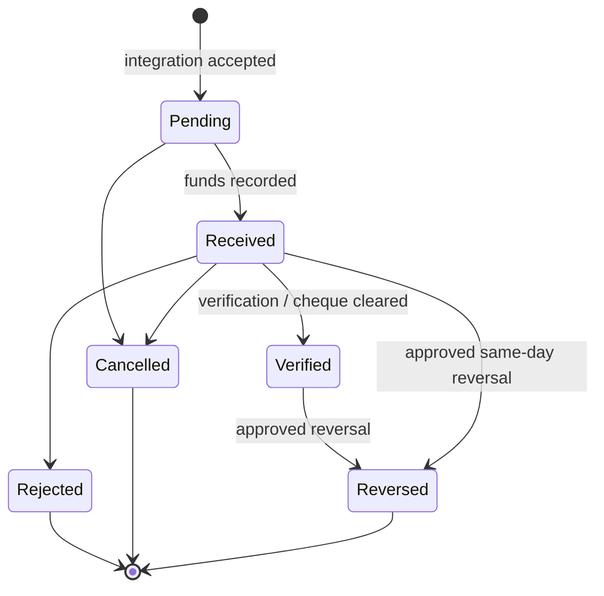
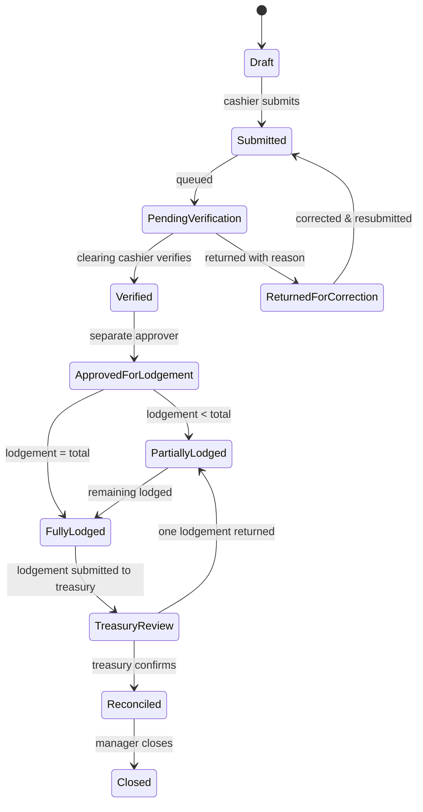
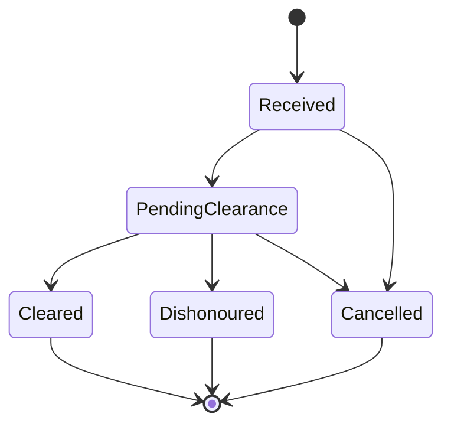
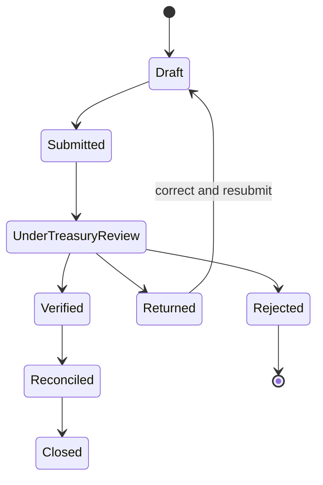
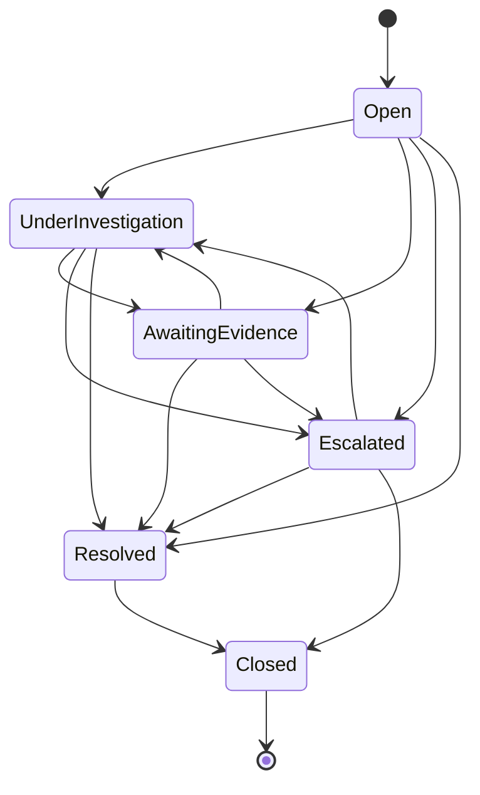
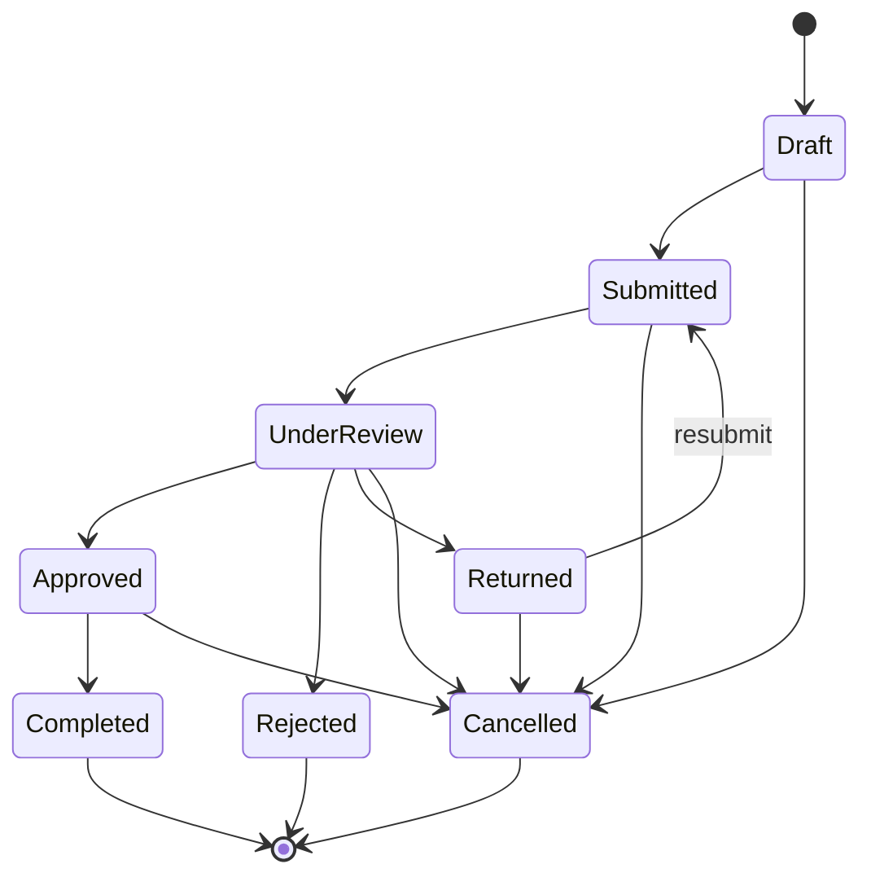
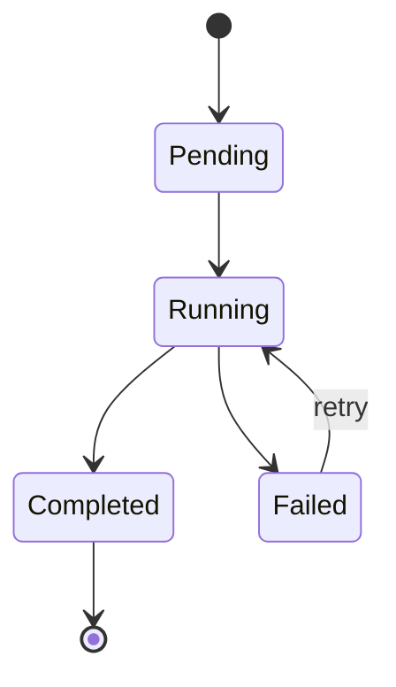
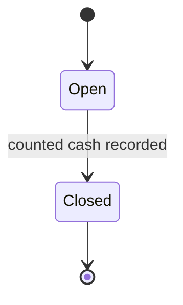

# Workflow States and Permitted Transitions

All transitions are enforced by `HasWorkflow::transitionTo()`. Status fields are guarded and cannot be changed by mass assignment. Every transition writes an append-only `workflow_transitions` row with actor and optional reason.

## 1. Payment

| From | To | Actor / trigger |
|------|----|-----------------|
| Pending | Received | Payment service on capture |
| Pending/Received | Cancelled | Cashier with `payments.cancel`, before batching |
| Received | Verified | Clearing verification or cheque clearance |
| Received | Rejected | Clearing/treasury rejection with reason |
| Received/Verified | Reversed | Approved `payment_adjustments` reversal; blocked once lodged |

Cash payments are `Received` immediately. Cheques carry `cheque_status` (`received → pending_clearance → cleared | dishonoured | cancelled`) and only become `Verified` when `cleared` is recorded.

## 2. Collection batch

| From | To | Permission | Note |
|------|----|------------|------|
| Draft | Submitted | `batches.submit` | Owner cashier; batch must have items |
| Submitted | PendingVerification | system | Automatic queue state |
| PendingVerification | Verified | `batches.verify` | Verifier ≠ submitter |
| PendingVerification | ReturnedForCorrection | `batches.verify` | Reason mandatory |
| ReturnedForCorrection | Submitted | `batches.submit` | Cashier corrects batch |
| Verified | ApprovedForLodgement | `batches.approve_lodgement` | Default: approver ≠ verifier |
| ApprovedForLodgement | Partially/FullyLodged | system | Driven by active allocations |
| FullyLodged | TreasuryReview | system | On lodgement submission |
| TreasuryReview | Reconciled | `treasury.confirm` | Fully confirmed |
| Reconciled | Closed | `batches.close` | Optional period close |

## 3. Cheque lifecycle

A dishonoured cheque creates a discrepancy and cannot be batched as verified funds. Clearance is recorded by a user with `payments.cheque_clear`.

## 4. Bank lodgement

| From | To | Permission |
|------|----|------------|
| Draft | Submitted | `lodgements.submit` |
| Submitted | UnderTreasuryReview | system |
| UnderTreasuryReview | Verified | `treasury.confirm` |
| UnderTreasuryReview | Returned | `treasury.confirm` / `lodgements.return` |
| UnderTreasuryReview | Rejected | `treasury.confirm` |
| Returned | Draft | `lodgements.create` (owner) |
| Verified | Reconciled | system |
| Reconciled | Closed | `reconciliation.close` |

Returning or rejecting a lodgement releases active allocations and recalculates batch lodged status.

## 5. Discrepancy

Resolution requires a resolution note and actor. Escalation notifies managers.

## 6. Account treatment

Approval progresses through configured stages. Each stage can require multiple approvals; stage order is enforced. A requester cannot approve their own request. Final approval sets `approved`; operational completion is a separate action (`treatment.complete`).

## 7. Reconciliation run

Runs are immutable after completion. Re-running creates a new run.

## 8. Cashier shift

## 9. Approval decisions (generic)

`pending → approved | rejected | returned`. Approval records are append-only; a returned stage causes the subject to return to its owner.
