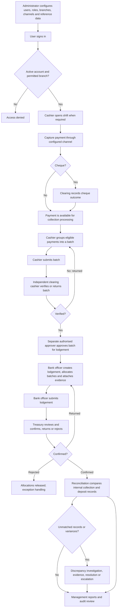

# System Process Flows

This document describes the end-to-end operational flows across the system. It complements [Workflow States and Permitted Transitions](./04-workflow.md), which is the detailed reference for status changes, and [System Requirements](./01-requirements.md), which describes intended controls and scope.

## 1. End-to-end operating model

The flow records transactions and evidence for payments processed outside this application. It does not itself collect funds through a payment gateway or obtain confirmation from a bank API.

## 2. Identity, access and setup

1. An administrator configures branches, collection points, banks, bank branches, payment channels, treatment types/reasons, approval workflows, system settings, roles and users.
2. The administrator assigns each user a primary branch, optional additional branches, an active state and one or more roles.
3. A user signs in with their own credentials. Password recovery uses the configured Laravel password broker.
4. Protected application screens require authentication and an active account. Each operation also checks the relevant permission and branch scope.
5. If an account is inactive, the user lacks permission, or the record is outside their branch scope, the operation must be denied without changing financial records.
6. Successful sensitive actions should be traceable in workflow history and/or audit records.

An administrator has no implicit financial approval authority merely by having the Administrator role. Assign operational permissions only to the appropriate operational roles.

## 3. Payment capture and receipt

1. The cashier selects an active payment channel and enters the payer, amount, date, branch, collection point and channel-specific details.
2. The application validates the selected channel's required fields, amount/date rules, actor access, and any external-reference or idempotency constraints.
3. The application creates the payment and generates its unique reference. A receipt is generated when required by the channel configuration.
4. Cash payments are immediately recorded as received. Non-cash channels retain their channel details and external settlement references for internal control.
5. A cheque is recorded with its cheque lifecycle status. It is not treated as cleared/verified funds until a permitted clearing user records clearance.
6. The cashier can view the payment and, if authorised, retrieve or reprint its receipt. Reprints are auditable.
7. An eligible payment may later be cancelled before batching. A reversal after capture follows the adjustment approval path rather than deleting the payment.

**Channel branches:** Cash, POS, AES, Direct Pay and Cheque share the capture process. POS/AES/Direct Pay may require external references, terminal/provider, bank or settlement date according to channel settings. Cheques require cheque details and a recorded clearance/dishonour outcome.

**Failure path:** Invalid or missing channel details, inactive channels, duplicates, future dates when disallowed, or an out-of-scope branch must return validation/authorization feedback and leave no partial payment or receipt behind.

## 4. Cashier shift and daily collection batch

1. A cashier opens a shift for an authorised branch and collection point. The application prevents a second simultaneous open shift for the same cashier.
2. Payments captured during the shift contribute to shift totals according to payment status and channel.
3. At shift close, the cashier enters the physical counted amount and optional notes. The application records the expected amount and variance. A variance is an exception to investigate, not an implicit correction to payments.
4. The cashier creates a batch and adds eligible unbatched payments. Each payment must belong to the correct branch/owner scope and must not already belong to another batch.
5. The cashier submits the batch with a declared total. Submission snapshots totals and sends the batch to the clearing queue.
6. A different clearing cashier checks the batch and enters the counted amount. Verification creates a verification record; an explained variance raises a discrepancy.
7. Clearing may verify the batch or return it for correction with a reason. On return, the cashier corrects the draft/returned batch and resubmits it.
8. A separately authorised approver approves a verified batch for lodgement. The verifier cannot approve it when the separate-approver control is enabled.
9. After lodgements cover the batch, authorised management can close the reconciled batch where period closure is used.

## 5. Cheque clearance and payment reversal

### Cheque

1. A cashier records a cheque payment with cheque details.
2. An authorised clearing user selects the recorded cheque outcome: cleared, dishonoured or cancelled, with notes where required.
3. A cleared cheque becomes eligible for the verified-funds path. A dishonoured cheque remains excluded from cleared funds and creates/updates an exception for follow-up.
4. The cheque decision, actor and resulting payment state remain available in the record history.

### Cancellation and reversal

1. Before batching, a cashier with cancellation permission may cancel an eligible payment and must supply a reason.
2. For a captured payment requiring reversal, an authorised user requests a reversal and supplies a reason.
3. An authorised independent approver approves or rejects the adjustment. Reversal is blocked where policy disallows it, including once a payment has been lodged.
4. Approval changes the payment through the controlled adjustment/workflow path; the original payment and decision history are retained.

## 6. Bank lodgement and treasury review

1. A bank officer opens a lodgement and records bank, bank branch, deposit slip number, deposit date, depositor and one or more approved batch allocations.
2. The application checks bank/branch consistency, duplicate deposit slips, branch scope, eligible batch status and remaining allocatable balance. Allocations cannot exceed the batch's approved total, including when multiple allocations exist.
3. The bank officer attaches the deposit evidence to private storage. The evidence is accessible only through an authorised application route.
4. The bank officer submits the lodgement. Required evidence and required submission fields are checked before the record enters treasury review.
5. A treasury officer who is not the submitting bank officer reviews the lodgement and evidence.
6. Treasury records a decision: confirm with bank confirmation reference and any required variance notes; return for correction; or reject with an explanation.
7. A returned lodgement can be corrected and resubmitted. A rejected/returned allocation is released for a later lodgement while historical decisions and evidence remain traceable.
8. Confirmed amounts refresh the related batch lodged status. Fully confirmed collections become eligible for reconciliation.

## 7. Reconciliation and discrepancy handling

1. An authorised user starts a reconciliation for a date range and optional branch.
2. The run compares internal payment, batch, active allocation and treasury-confirmation records. It stores a run reference, summary and item-level results.
3. A matched item records the expected/actual match. An unmatched payment or lodgement is recorded as an exception; a corresponding discrepancy is created if one does not already exist for the same open issue.
4. The user investigates an open discrepancy, records evidence/findings and moves it through investigation, awaiting evidence, escalation, resolution and closure as permitted.
5. Resolution requires a resolution note. Escalation assigns/notifies the responsible manager where notification is configured.
6. Re-running reconciliation creates a new run; completed runs and their items remain available for audit comparison.

Reconciliation is internal-record matching, not an external statement import or bank API process.

## 8. Account treatment request and approval

1. An authorised user selects an account, treatment type and reason, enters the request details/amount, and optionally links a relevant payment, batch, lodgement or reconciliation.
2. The request starts as a draft. The requester can edit it and attach required documents while it is editable.
3. On submission, the application checks required fields/documents and creates approval-stage work from the configured workflow.
4. Each assigned approver reviews only the current stage and records approve, return or reject. The requester cannot approve their own request; stages and required approval counts are enforced.
5. A returned request goes back to the requester for correction and resubmission. A rejection terminates the approval path.
6. Final approval marks the request approved. An authorised operations user completes the treatment separately and records completion notes.
7. A permitted requester may cancel an eligible request with a reason. Request, documents, decisions and transitions remain auditable.

Approval authorises the treatment request; it does not itself post a ledger entry or mutate linked payment/batch/lodgement amounts.

## 9. Exceptions, reporting and governance

- **Discrepancies:** Exceptions may arise from shift, clearing, cheque, lodgement or reconciliation variance. Users with the relevant permission investigate, add resolution notes, assign/escalate and close.
- **Dashboard and reports:** Users view role-appropriate operational summaries, apply available date/branch/status filters and remain within their branch scope.
- **Exports:** An authorised user selects a report, filters and supported format. The export should retain the requesting user, criteria, format and status; download access must be authorised. Whether every export is queued depends on the configured implementation.
- **Notifications:** Workflow actions may create database notifications for affected users. Users can inspect notifications and mark one or all as read.
- **Audit:** Sensitive changes, decisions, exports, downloads and workflow transitions should retain actor and timestamp evidence. Financial corrections use cancellation/reversal/adjustment records rather than silently deleting history.
- **Profile:** A signed-in user can update allowed profile fields and change their password only after supplying the current password and a valid confirmed replacement.

## 10. Operational sequence for a full acceptance run

1. Seed/configure a test organisation with branches, collection points, banks, channels, roles and test users.
2. Sign in as a cashier; open a shift and record one payment for each enabled channel.
3. Exercise cheque clearance, a cancellation before batching and an approved/rejected reversal in separate scenarios.
4. Close the shift and create/submit a batch. Verify the batch as a different user, test a return/correction, then approve it as a third role where configured.
5. Create a multi-batch or partial bank lodgement, attach evidence and submit it. Confirm one lodgement; return or reject another and verify allocations are released.
6. Run reconciliation for a period containing both matched and intentionally unmatched records. Investigate and close at least one discrepancy.
7. Submit and process account treatment requests through each configured approval stage, including return, rejection, self-approval denial and completion.
8. Review role-specific dashboards/reports, test export permissions and private document access, inspect notifications and audit/workflow history.
9. Repeat negative scenarios using inactive, wrong-branch and insufficient-permission users. Confirm no protected state changes.

## 11. Implementation and verification boundary

This flow is an operational and QA reference, not proof that every described path has an automated test or external integration. The current PHPUnit inventory is summarized in [System Test Cases](./07-test-cases.md). In particular, do not treat bank API matching, statement imports, ledger posting, scheduled overdue processing or queued export delivery as implemented unless verified in the current deployment and code.
